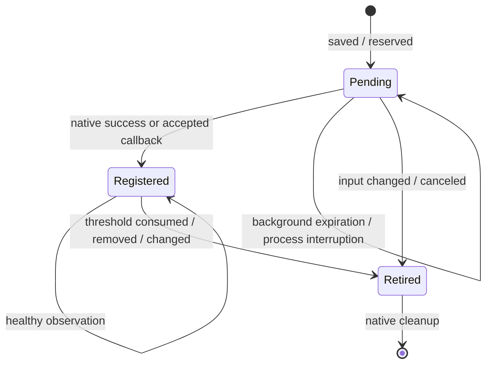

# Enforcement stability and usability

Task: https://app.notion.com/p/41516e0e0e3a81dfb1b0f7f45f43fb02
Related crash: https://app.notion.com/p/41516e0e0e3a819eaba8cac14cf8776a

This change consolidates draft PR #32 with the usage-registration fix and the defects found in an independent codebase audit. Scope is enforcement, persistence, and the user flows that mutate or explain them. NFC identity, saved list/rule identities, active-edit restrictions, cooldowns, daily allowance policy, website blocking, and emergency access remain the product contract. No new feature or deployment is included.

## Transition rules

| Operation | Before native IPC | Completion / interruption |
| --- | --- | --- |
| Save / retry | Persist desired rule, synchronously admit bounded background work | Reconcile latest semantic inputs; preserve healthy monitors; expiration leaves durable work for activation |
| Usage threshold | Accept current generation, persist deadline, release lease, apply shield | Stop consumed allowance / register expiry outside lease; stale completion cannot reset cycle |
| Break start | Reserve pending end for current activation; keep shield | Successful current reservation publishes break and clears shield; failure/expiration keeps protection |
| Temporary block | Persist pending session and expiry reservation | Shield only after accepted registration; failure rolls back initial session; restart reconciles same deadline |
| End / release / delete | Invalidate owner and persist shield intent | Apply/clear before native retirement; no reused monitor identities |
| Foreground / background | Routine timers follow scene activity; accepted commands have independent finite lifetime | Expiration disables effect admission and lease retries; late native returns cannot commit while disabled |
| Shield write | Persist version + in-flight writer process, release lease | Validate revision; replay newer intent; prune only writers proven dead (ESRCH); compact settled deleted-owner clears |
| Store load failure | Keep original bytes and expose a load error | Prevent automatic flush and editing from overwriting unreadable data; successful reload restores writes |

State transactions are synchronous and short. The outermost lease flushes preferences, unlocks, then emits effects. Shield effects precede monitor cleanup. App-owned effects execute off MainActor under a background assertion; extension callbacks drain effects outside their lease. DeviceActivity reservation/completion checks use current persisted inputs, including early callbacks and changed inputs after a callback. Diagnostics snapshot native registration off MainActor too.

The daily usage window remains midnight through 23:59:59, repeating. Apple's `DeviceActivitySchedule.nextInterval` describes the current interval when ongoing; its `includesPastActivity` documentation explicitly describes starting within an existing interval. There is no source-backed reason to replace it with a second bootstrap monitor. `includesPastActivity` remains false. Physical counting is still an acceptance requirement.

Sources:
- https://developer.apple.com/documentation/deviceactivity/deviceactivityschedule/nextinterval
- https://developer.apple.com/documentation/deviceactivity/deviceactivityevent/includespastactivity

## Regressions and verification

- `NativeBoundaryQA`: executes the 903 production callback/lifecycle checks with every DeviceActivity read/start/stop probed using an independent kernel-flock descriptor, plus deferred shield effects. Prior PR revision `d89db87` fails with native IPC under flock; candidate passes.
- `StoreDurabilityQA`: corrupt current-store bytes survive load, flush, attempted edit, and valid reload. `d89db87` fails by overwriting saved rules; candidate passes.
- `ForegroundRecoveryQA`: Save while final observation is stalled → Home → latest monitor completes without relaunch; no synthetic progress; healthy identity retained; break native registration stalls off MainActor with lease free; Home permits bounded completion, expiration rejects a late commit; activation reconciles pending success; stale tag/timer shields clear.
- `ShieldQA`: existing cross-process stale/shrink/clear interleavings plus process exit during write, successful retry settling, and deleted-owner tombstone compaction (31 checks).
- `MonitorLedgerQA`: early callback/late result, changed semantic inputs after callback, ABA identity, invalidation, restart and orphan cleanup.
- Existing callback, activation, schedule-window, mutation, NFC, cooldown, migration, recovery presentation and transaction suites remain in `scripts/check.sh`.
- UI tests cover both Save buttons rejecting blank names, a confirmed registration with no usage report, background/resume preserving an unsaved editor, authorization recovery, temporary-session errors, and diagnostics. Presentation fixtures are explicitly labeled and do not demonstrate real Screen Time enforcement.

## Device acceptance and limits

Verify on the reported iOS/build family: create a 10-minute Instagram limit, leave immediately, use it past threshold, observe actual shield, wait for original lock deadline, and repeat a second cycle without relaunch. Also test save/edit during recovery, break start→lock screen, 20 open/lock/unlock cycles inside/outside schedule windows, NFC and emergency release, and absence of new 0xdead10cc reports. Native registration/readback or simulator fixtures cannot establish these outcomes.

A live stalled native IPC cannot be forcibly interrupted. On assertion expiration this code stops new effects and commits; durable reservations are reconciled on activation. PID reuse or inaccessible liveness checks conservatively retain a shield writer receipt rather than incorrectly declare a still-live writer dead. Unreadable data is preserved, not automatically repaired. No physical-device acceptance, merge, or TestFlight delivery is claimed.
