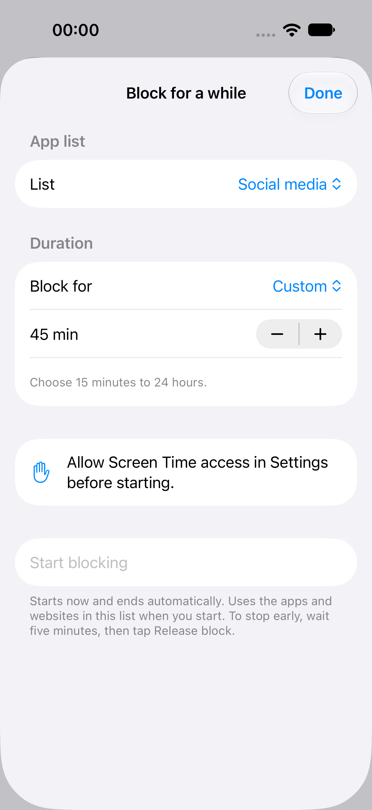

# Repeat usage lockouts and ad hoc sessions

Implementation branch: `codex/usage-cycle-adhoc`.

## Usage cycle candidate

Blake reported that the first usage lockout ended early and the next allowance did not trigger another lockout. That exact phone callback sequence has not been captured. These changes harden the cycle; they do not establish the root cause of the on-device report.

Each new allowance registers a fresh usage activity identity, excludes past activity on iOS 17.4+, and removes the consumed activity after successful replacement. Stale threshold callbacks are ignored. Failed replacement retains the previous registration and records a visible error with Retry block in Focus. Launch retries recorded registration failures. The persisted lock deadline continues to govern release; a missing expiry monitor is repaired without extending the deadline. Short recovery windows use a 15-minute interval with a warning at the actual deadline.

Unified logs use the existing app subsystem with categories `UsageCycle` and `MonitorCallbacks`. They record activity identity, callback type, lock deadline and registration outcome, without selected app tokens.

Apple reference: [includesPastActivity](https://developer.apple.com/documentation/deviceactivity/deviceactivityevent/includespastactivity).

Live numeric usage is still the separate unfinished task. Monitor registration is not evidence of actual device enforcement.

## Ad hoc sessions

Focus → Block for a while → existing list → 30 minutes / 1 hour / 2 hours / custom. Custom durations run from 15 minutes to 24 hours in 15-minute steps. One session can run at a time. No saved rule is created.

The temporary session persists separately, snapshots the selected list, and uses its own shield stores. Editing or deleting the original list cannot weaken it. Expiry removes the session. Stop early starts a persisted five-minute wait and then requires an explicit Release block tap. Other blocks keep their shields. Emergency Access clears the session too.

If background expiry registration fails, the new session is rolled back and an error is shown before any shield is applied. Screen Time authorization is required by both the UI and manager.

This screenshot is the real simulator form, with a seeded list and unavailable Screen Time authorization. It verifies layout, selection, custom duration and the permission gate; it does not show actual phone shielding.

## Validation

- 32 lifecycle checks passed against production usage, break, ad hoc and extension code with explicit OS/store doubles. Covers second-cycle lockout, stale threshold, full-deadline guard, registration failure/retry, missing expiry repair, ad hoc rollback, persistence, timed expiry, explicit early release and independent shield preservation.
- Eight schedule-registration checks, 16 calendar checks and 25 domain/status checks passed.
- Three focused simulator UI tests passed across runs: existing status review, active-rule protection, and new ad hoc setup/custom-duration selection. The first run's picker lookup and offscreen row failures were corrected in the tests; the final two-test rerun passed.
- UI result bundles: `/tmp/tyri-adhoc-ui-final.xcresult` (status review passed; initial selectors failed), `/tmp/tyri-adhoc-ui-verified.xcresult` (both corrected tests passed).
- Debug app and monitor compiled as part of the UI runs. Final Release build result is recorded in `/tmp/tyri-adhoc-release.log`.

## Phone acceptance before closing the tasks

1. Upgrade preserving existing lists and rules. Complete two full use → lockout → use → lockout cycles with Tyri suspended, then repeat through app relaunch. Confirm each lock lasts its full saved duration. If access returns early, collect the unified logs and exact rule/build details.
2. Start an ad hoc session, close Tyri, and confirm the apps stay blocked until expiry. Confirm expiry works while Tyri is closed.
3. Start a session overlapping another block. End the session and confirm the independent block still applies.
4. Start Stop early, relaunch during the wait, and confirm neither relaunch nor wait completion releases automatically. Tap Release block after the wait.

TestFlight 2.3 (9) uploaded successfully on November 3, 2026 at 05:22:25 UTC. Apple reports processing. Both app and monitor distribution signatures, Store profiles, versions and required entitlements were verified. The three screenshots are embedded in the Tyri Notion project page; the ad hoc setup screenshot is also on its task card. Both task cards remain In progress pending physical-device acceptance.
